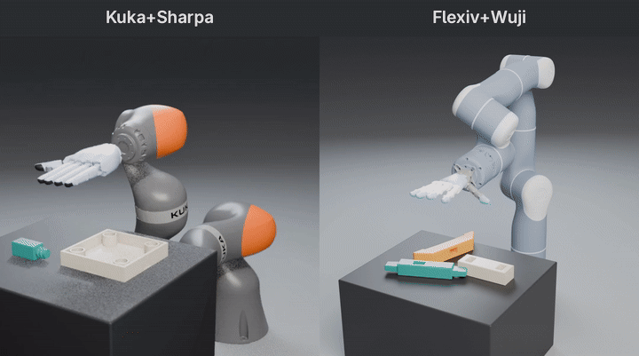

# Play2Perfect

### What Matters in Dexterous Play Pretraining for Precise Assembly?

Official code release for **Play2Perfect**, a 2-stage reinforcement-learning pipeline for
contact-rich robotic assembly with dexterous hands, released for **two arm + hand setups**:
a KUKA iiwa 14 with a Sharpa hand and a Flexiv Rizon 4s with a Wuji Hand 2.

📄 **Paper:** https://arxiv.org/abs/2606.26428

<p align="center"></p>

## Overview

Play2Perfect learns precise, contact-rich assembly in two stages:

1. **Play** — pretrain a policy by playing with random objects in free space.
2. **Finetune** — finetune the play policy on a contact-rich assembly task.

This repository provides:

- **Two robot setups**, each with its own play and assembly environments and checkpoints
  (see [Robot setups](#robot-setups)).
- **Training** code for both stages in Isaac Sim (Isaac Lab).
- **Interactive (viser) evaluation** for four assembly tasks plus two everyday-object
  insertions, using our released checkpoints, with a robot switch in the GUI.
- A **minimal sim-to-real deployment** reference.

> This release targets **Isaac Sim only**.

## Project structure

```
play2perfect/
├── isaacsimenvs/          # Training: Stage-1 play env + Stage-2 precise-assembly env
│   ├── train.py           # Single training entry point (both stages)
│   ├── cfg/               # Hydra task + train configs
│   └── tasks/{play,precise_assembly}/
├── evaluation/         # Released tasks: problem registry + viser evaluation
│   ├── problems/          # peg-in-hole, fabrica beam parts 0 & 2, furniture-bench, fork & plug
│   └── eval_isaacsim.py   # Interactive viser evaluation
├── rl_games/              # Vendored RL library (PPO + SAPG)
├── deployment/            # Minimal sim-to-real reference
├── assets/urdf/           # Robots (KUKA+Sharpa, Flexiv+Wuji) + task assets
└── docs/                  # Installation + deployment guides
```

## Robot setups

| Setup | Arm + hand | Play task | Assembly task | Released checkpoints |
|-------|------------|-----------|---------------|----------------------|
| `kuka_sharpa` | KUKA LBR iiwa 14 + Sharpa hand | `Isaacsimenvs-Play-Direct-v0` | `Isaacsimenvs-PreciseAssembly-Direct-v0` | play + all six tasks (paper setup) |
| `flexiv_wuji_right_human_like` | Flexiv Rizon 4s + right Wuji Hand 2 | `Isaacsimenvs-PlayFlexivWujiRight-Direct-v0` | `Isaacsimenvs-PreciseAssemblyFlexivWujiRight-Direct-v0` | play + every task except screwing (snapshots of runs still training) |

Both setups share the same two-stage recipe, task definitions and evaluation tools; only the
robot (and its table placement) changes.

## The four assembly tasks

| Task | `problem` key |
|------|----------------|
| Tight insertion (L-peg, 0.5 mm tolerance) | `tight_insertion` |
| Beam assembly — step 1 | `beam_assembly_step1` |
| Beam assembly — step 2 | `beam_assembly_step2` |
| Screwing (furniture leg) | `screwing` |

### Everyday-object insertions

Two additional tasks with real-world-scale everyday objects, finetuned from the same
Stage-1 play policy with the same environment and settings as the paper tasks:

| Task | `problem` key |
|------|----------------|
| Fork into a flatware holder (YCB fork scan, handle first, 1 mm clearance) | `fork_insertion` |
| USB-C wall plug into a power-strip socket (1.5 mm blades, 0.5 mm clearance) | `plug_insertion` |

## Installation

See [docs/isaacsim_installation.md](docs/isaacsim_installation.md) for the full Isaac Sim /
Isaac Lab setup (Python 3.11, `.venv_isaacsim`).

## Quick start

### 1. Download checkpoints

```bash
# Stage-1 play policy + the finetuned assembly policies (KUKA iiwa 14 + Sharpa hand)
python download_checkpoints.py

# The same for the Flexiv Rizon 4s + right Wuji Hand 2 (no screwing policy yet)
python download_checkpoints.py --robot flexiv_wuji_right_human_like
```

### 2. Interactive evaluation (viser)

```bash
# One problem from a single checkpoint
python evaluation/eval_isaacsim.py \
  --checkpoint-path pretrained_assembly/tight_insertion/model.pth \
  --problem tight_insertion \
  --port 8080

# ...or load all downloaded policies and switch between them in the GUI
python evaluation/eval_isaacsim.py --policies-dir pretrained_assembly --port 8080

# With both robots' checkpoints downloaded, no policy args gives a Robot dropdown too;
# the policy is fixed by the chosen robot and problem
python evaluation/eval_isaacsim.py --port 8080
```

Open `http://localhost:8080` in a browser to watch the policy roll out the insertion.

### Offline success-rate evaluation

Headless, batched eval that scores each problem over many parallel envs (one
i.i.d. first-episode trial per env) and prints a success-rate table:

```bash
python evaluation/eval_offline.py --policies-dir pretrained_assembly
```

### 3. Train Stage 1 (play)

```bash
python isaacsimenvs/train.py \
  --task Isaacsimenvs-Play-Direct-v0 \
  --agent rl_games_cfg_entry_point \
  --headless
```

For the Flexiv + Wuji setup, use `--task Isaacsimenvs-PlayFlexivWujiRight-Direct-v0`.

### 4. Finetune Stage 2 (precise assembly)

```bash
python isaacsimenvs/train.py \
  --task Isaacsimenvs-PreciseAssembly-Direct-v0 \
  --agent rl_games_cfg_entry_point \
  --checkpoint pretrained_policy/model.pth \
  env.precise_assembly.problem=tight_insertion \
  --headless
```

For the Flexiv + Wuji setup, use `--task Isaacsimenvs-PreciseAssemblyFlexivWujiRight-Direct-v0`
and start from `pretrained_policy_flexiv_wuji/model.pth`.

## Deployment

See [docs/deployment.md](docs/deployment.md) for the minimal sim-to-real reference.

## Formatting

```bash
./format.sh   # ruff over the Python packages + xmllint over URDFs
```

## Acknowledgements

This codebase builds on excellent prior work:

- [**rl_games**](https://github.com/Denys88/rl_games) — the high-throughput RL library our
  training loop is built on (vendored here).
- [**SAPG**](https://sapg-rl.github.io/) — Split and Aggregate Policy Gradients, the
  large-scale PPO variant we use for training.
- [**SimToolReal**](https://github.com/tylerlum/simtoolreal) — our prior work on
  object-centric tool manipulation, which the Stage-1 "play" pretraining is based on.

## Citation

```bibtex
@misc{lum2026play2perfectmattersdexterousplay,
      title={Play2Perfect: What Matters in Dexterous Play Pretraining for Precise Assembly?},
      author={Tyler Ga Wei Lum and Kushal Kedia and C. Karen Liu and Jeannette Bohg},
      year={2026},
      eprint={2606.26428},
      archivePrefix={arXiv},
      primaryClass={cs.RO},
      url={https://arxiv.org/abs/2606.26428},
}
```

## Contact

- Kushal Kedia — kk837@cornell.edu
- Tyler Lum — tylerlum@stanford.edu
