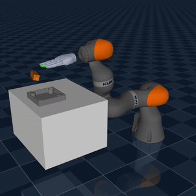
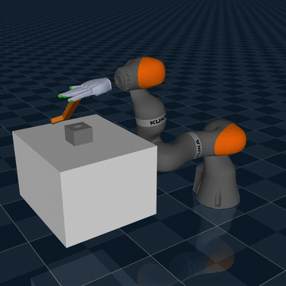
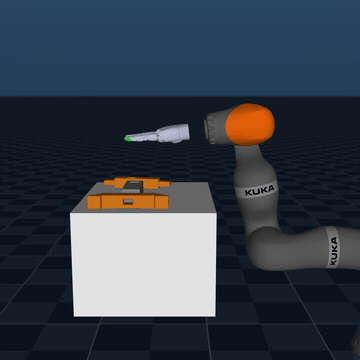
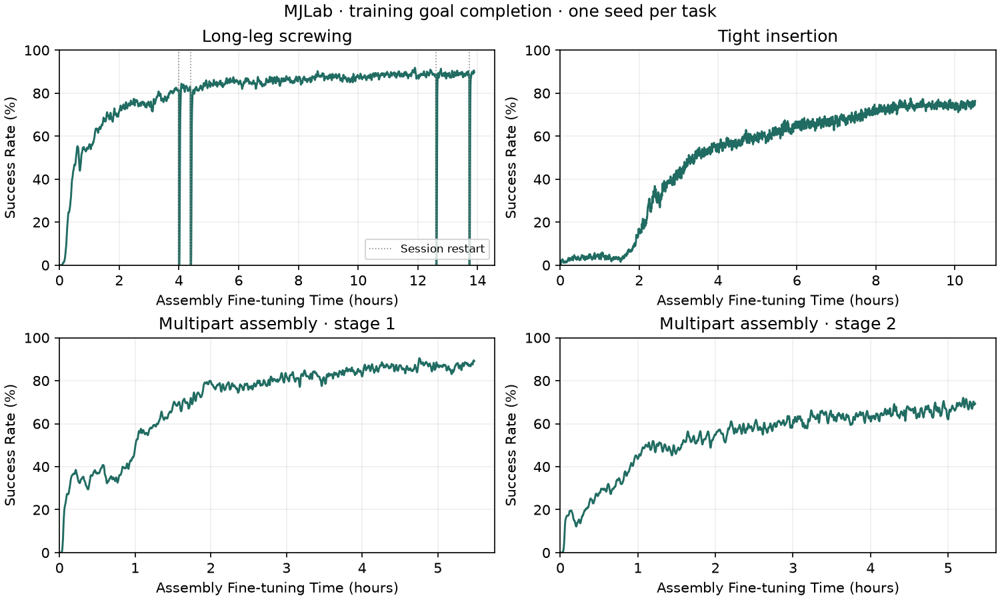

# Play2Perfect assembly fine-tuning in MJLab

Fine-tune the pre-trained play policy for long-leg screwing, tight insertion
and two-stage beam assembly in MJLab, using KUKA iiwa 14 + Sharpa.

The package includes four training recipes, checkpoint resume, policy evaluation,
MuJoCo rendering and training plots. CPU/CUDA learner checks and clean-install CI
are documented in the [validation records](validation/README.md).

Play2Perfect supports assembly fine-tuning in both Isaac Lab and MJLab.
This backend supports KUKA/Sharpa; Flexiv/Wuji support is available in Isaac Lab.

## Task demos

All three policies are fine-tuned in MJLab from the **pre-trained play policy**.
The full KUKA arm and Sharpa hand are simulated. The GIFs show selected successful
rollouts, rendered in MuJoCo at 1× simulation time from recorded states.

| Demo | Task and recipe | MJLab training / measured result |
|:---:|---|---|
|  | Long-leg screwing<br>`long_leg_fine_v1` · [MP4](docs/media/screwing.mp4) | 1,000.02M steps; 96/128 clean endpoints, source history |
|  | Tight insertion<br>`tight_stabilized_v1` · [MP4](docs/media/tight_insertion.mp4) | 1,002.33M steps; 16/32 clean endpoints, immediate feedback |
|  | Multipart<br>`beam_step1_v1` + `beam_step2_v1` · [MP4](docs/media/multipart.mp4) | 100.41M / 100.60M steps per stage; one composed sequence |

Multipart fixes the first part after handoff; stage scores are reported separately.
See [reproduction instructions and training curves](docs/REPRODUCING.md) for the
checkpoint budgets, evaluation protocols and release-stability results.



Success here means all assembly goals reached during training. The curves use a
20-update trailing mean and a 0–100% scale. Clean withdrawal is measured separately
in the table above. [Reward curves and metric definitions](docs/REPRODUCING.md#reference-results)
remain available.

## Install and prepare

Use Linux, Python 3.11, Git and [uv](https://docs.astral.sh/uv/). Commands below
run from this `mjlab/` directory. No private checkout, Stanford storage or
`PYTHONPATH` is needed. CPU checks work without a GPU.

```bash
cd mjlab
export UV_PROJECT_ENVIRONMENT="$PWD/.venv-cpu"
uv sync --locked --project environments/sapg-sdf-candidate-cpu
uv run --no-sync --project environments/sapg-sdf-candidate-cpu p2p-mjlab-assets
uv run --no-sync --project environments/sapg-sdf-candidate-cpu p2p-mjlab-foundation
uv run --no-sync --project environments/sapg-sdf-candidate-cpu \
  python scripts/prepare_warp_stabilization.py
```

Assets use immutable public revisions and SHA-256 checks. The pre-trained
checkpoint download is about 414 MB. Existing changed inputs are rejected
rather than overwritten.
See [sources and notices](third_party/README.md).

The pinned stack uses MJLab `8bb2bc9e`, MuJoCo 3.12, Warp 1.18 and the mesh-SDF
candidate `230fe303`. Long-leg and insertion recipes also use a verified
free-body stabilization patch. The overlay changes only the launched process;
it does not edit installed packages. Stock/current MJLab versions have not been
qualified as drop-in replacements.

## Check the learner

```bash
MUJOCO_GL=disable CUDA_VISIBLE_DEVICES='' \
uv run --no-sync --project environments/sapg-sdf-candidate-cpu \
  python scripts/smoke_training.py --output-dir runs/cpu_smoke \
  --discard-intermediate-checkpoints
```

This runs six worlds, four controls and one update for each recipe. It restores
the saved actor, critic, both optimizers, random states and task progress, then
checks another update. It also reads actual native/Warp solver settings. Physical
episodes and recurrent memory restart on resume. This is a software test, not a
task-success measurement. Use a fresh output directory for each invocation.

## Train

Install the separate CUDA environment on a machine with a compatible NVIDIA
driver. Its Torch build uses CUDA 13.0. Keep the CPU environment for evaluation.

```bash
export UV_PROJECT_ENVIRONMENT="$PWD/.venv-cuda"
uv sync --locked --project environments/sapg-sdf-candidate-gpu
MUJOCO_GL=disable \
uv run --no-sync --project environments/sapg-sdf-candidate-gpu \
  python scripts/train_recipe.py --recipe long_leg_fine_v1 --run-dir runs/long
```

| Recipe | Physics step × substeps | SDF samples | Worlds / minibatch | Stabilization overlay |
|---|---|---|---|---|
| `long_leg_fine_v1` | 1/600 s × 10 | 10 | 1536 / 12288 | Yes |
| `tight_stabilized_v1` | 1/120 s × 2 | 10 | 1536 / 12288 | Yes |
| `beam_step1_v1` | 1/120 s × 2 | 50 | 768 / 6144 | No |
| `beam_step2_v1` | 1/120 s × 2 | 50 | 768 / 6144 | No |

All recipes control at 60 Hz, with horizon 16, Newton 100 / line-search 50 and
EPA capacity 64. Beam stages need 512 contact slots per world; the other recipes
use 128. Defaults preserve the historical training configurations.

Resource and learner options pass through to `scripts/train_sapg.py`; use its
`--help` for the full list. For a smaller run, set both `--num-envs` and
`--minibatch-size`. World count must be divisible by six. The minibatch must
divide `num_envs × horizon` and contain whole recurrent sequences. Explicit
overrides produce a different experiment and enter the saved configuration.

Checkpoints and `metrics.jsonl` appear in the run directory. `config.json`
records checkpoint ancestry, source identity, learner/task contracts and runtime
versions. `actual_options.json` records compiled physics settings. Capacity
overflow rejects the rollout; nonfinite states are captured and counted.

Resume into a **new** directory with the same recipe and resource shape:

```bash
MUJOCO_GL=disable \
uv run --no-sync --project environments/sapg-sdf-candidate-gpu \
  python scripts/train_recipe.py --recipe long_leg_fine_v1 \
  --resume runs/long/checkpoint_00001000.pth --run-dir runs/long_resume
```

The checkpoint number is illustrative; use an existing saved checkpoint.
`--resume` restores the complete MJLab learner. `--checkpoint` starts a new
fine-tuning run and fresh optimizers from weights. They are different operations.

## Evaluate and record

Use the frozen learner's conditioning block `0`. Released website actors use a
different conditioning convention; do not silently switch it for a score.
This long-leg example records every control and saves its compiled model:

```bash
export UV_PROJECT_ENVIRONMENT="$PWD/.venv-cpu"
MUJOCO_GL=disable CUDA_VISIBLE_DEVICES='' \
uv run --no-sync --project environments/sapg-sdf-candidate-cpu \
  python scripts/run_warp_overlay.py --source-root .cache/mujoco_warp_sdf_gyro \
  --script scripts/evaluate_released_monitored.py -- \
  --health runs/long_eval/health.json -- \
  --bundle data/long_leg/long_leg \
  --checkpoint runs/long/checkpoint_00001000.pth \
  --conditioning 0 --history source --num-envs 8 --seed 161803 --device cpu \
  --physics-dt 0.0016666666666666668 --decimation 10 \
  --sdf-initpoints 10 --nconmax 512 --njmax 2048 --epa-horizon 64 \
  --steps 6500 --max-seconds 5400 --record-every 1 \
  --trajectory runs/long_eval/poses.npz --output runs/long_eval/result.json
```

Report `declared_start_metrics`: every declared start remains in the denominator,
including early failures and unfinished episodes. Legacy valid-episode rates
remain separate for source comparisons. All-goal completion, source withdrawal
and contact-free withdrawal are different metrics. A contact-free endpoint does
not establish later retention or real-robot transfer.

`--history source` uses the training queue lengths (10/3/3 for object state,
observation and action). It matches the long-leg reference evaluation.
The default `--history immediate` uses 1/1/1 and preserves earlier offline
evaluation behavior. Native MuJoCo evaluation supports immediate feedback only.
Both retain the public offline reset/scoring rules; the queue profile is recorded.

For the insertion reference, use `--history immediate`,
`data/released_evaluation/tight_insertion`, timestep
`0.008333333333333333`, decimation `2`, and the same overlay/SDF10 settings.
For separate beam stages, use `--history immediate`, the paths below, SDF50 and 1/120 × 2 without the
overlay. Run `scripts/evaluate_released_monitored.py` directly in that case.

| Task | Prepared bundle |
|---|---|
| Beam stage 1 | `data/released_evaluation/beam_assembly_step1` |
| Beam stage 2 | `data/released_fixture_left/beam_assembly_step2` |
| Composed multipart | `data/public_beam_sequence` |

The composed diagnostic uses both trained policies with continuous state and a
recurrent-state reset at handoff:

```bash
MUJOCO_GL=disable CUDA_VISIBLE_DEVICES='' \
uv run --no-sync --project environments/sapg-sdf-candidate-cpu \
  python scripts/evaluate_beam_sequence.py --backend mjlab --conditioning 0 \
  --bundle data/public_beam_sequence \
  --stage1-checkpoint runs/beam1/checkpoint_00001000.pth \
  --stage2-checkpoint runs/beam2/checkpoint_00001000.pth \
  --allow-measured-collider-difference --record-every 1 \
  --output runs/multipart_eval
```

This is one canonical sequence, not a randomized joint success rate. The prepared
stage and composed models use the same part masses: 68.57 g and 85.98 g. The
composed scene fixes the first part after handoff. Its fused seated fixture has
a measured geometry difference, so the diagnostic requires the explicit flag
above. Stage scores
must not be reported as a joint sequence success rate.

## Render and plot

Install system `ffmpeg` and provide an EGL-capable graphics environment. The
renderer replays dense recorded states through native MuJoCo. It performs no
physics integration or motion interpolation. The robot has a physical seven-joint
arm; close camera views can crop its base.

```bash
MUJOCO_GL=egl \
uv run --no-sync --project environments/sapg-sdf-candidate-cpu \
  python scripts/render_presentation_recording.py \
  --model runs/long_eval/poses.mjb --recording runs/long_eval/poses.npz \
  --world 0 --azimuth 145 --elevation -22 --distance 1.85 \
  --lookat 0 0.3 0.44 --style native --output runs/long_video

uv run --no-sync --project environments/sapg-sdf-candidate-cpu \
  python scripts/plot_training.py --run-dir runs/long \
  --run-dir runs/long_resume --output runs/long_curves
```

Plots show training rewards and goal metrics against transitions and recorded
process time. They include environment/learner setup and compilation, but exclude
queueing, imports before `main` and downtime. Resume rollback work remains charged.
Use frozen evaluation cohorts for success-rate curves.

See [Reproducing the reference experiments](docs/REPRODUCING.md) for all four
training commands, exact budgets, hardware, raw curve data and video provenance.

## Scope and limitations

- The long-leg recipe uses a 7.5 mm effective keypoint tolerance. Upstream Isaac
  Lab uses a 5 mm setting multiplied by `keypoint_scale=1.5`, also 7.5 mm.
  Matching that threshold alone does not make the full evaluation protocols equal.
- Physics fidelity and performance vary by task. Smaller physics steps are not
  uniformly better. This package preserves tested settings rather than claiming
  simulator-identical trajectories.
- The first release excludes play pretraining, tool-use tasks,
  cluster scripts and experiment dashboards.
- Example videos are selected rollouts. Inspect cohort results and contact
  diagnostics before judging reliability or sim-to-real readiness.
