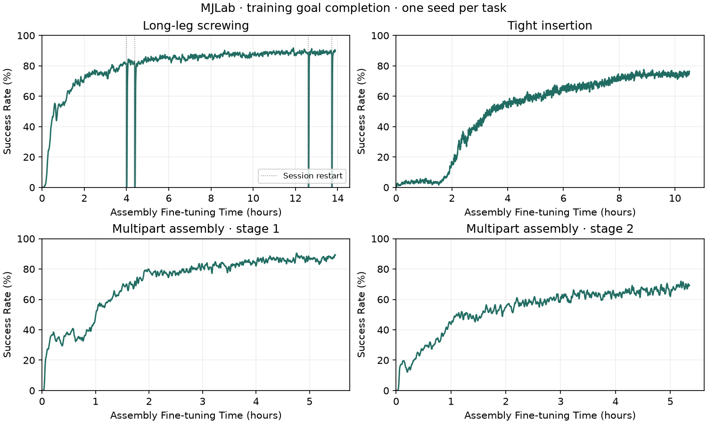
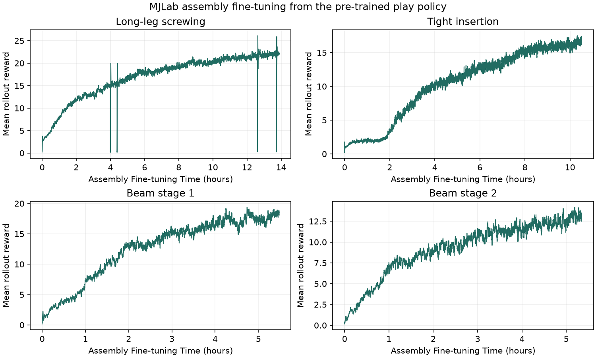

# Reproduce MJLab assembly fine-tuning

All four recipes start independently from the pre-trained play policy,
distributed as Play2Perfect's `play/model.pth`. Its SHA-256 is
`4cb0d09833326de6878ee5681c2b14521823fa616e01b135214a51ffe41c63b9`.
The play policy was trained in Isaac Gym. Actor and critic optimizers start
fresh for MJLab assembly fine-tuning; the pre-trained network and exploration
parameters are inherited.

The plots below come from the research implementation before package extraction.
The extracted package passes CPU/CUDA update and resume checks. Its full
128-start frozen Long evaluation also reproduces all archived research states
and 96 clean endpoints; see the [validation record](../validation/2026-11-05/long_reference.json). A fresh
full-scale reproduction from this public package has not yet completed. Treat
these as reference experiments, not a guarantee of identical curves.

## Reference results



The y-axis is **Success Rate (%)**, from 0 to 100. Success means all assembly
goals reached in the latest completed training episode per world. It does not
require clean withdrawal or retention after release. The x-axis is
**Assembly Fine-tuning Time (hours)**, using the recorded warm-time clock below.

| Task | Final training success | Peak training success |
|---|---:|---:|
| Long-leg screwing | 89.7% | 91.8% |
| Tight insertion | 76.4% | 77.6% |
| Multipart stage 1 | 89.1% | 90.5% |
| Multipart stage 2 | 69.4% | 72.0% |

These are the final and peak values of the plotted trailing mean, not frozen-policy
test scores. All four tasks are shown. Raw values and exact summaries are available
in the [reference data](reference/manifest.json) and [plot summary](media/success_summary.json).

<details>
<summary>Reward curves</summary>



</details>

Each line uses a trailing mean of up to 20 updates, reset at each session boundary.
The included compressed CSV files retain every accepted scalar without smoothing.
The dotted lines mark session restarts; brief dips include reset episode counters.
Reward is the shaped reward per control step, averaged over six equal-size SAPG
blocks. It is not episode return. Each task has its own reward scale.

| Recipe and detailed plots | Transitions | Warm hours | GPU | Worlds | Duty cycle |
|---|---:|---:|---|---:|---:|
| [Long-leg screwing](media/long_leg_fine_v1.png) | 501,104,640 | 13.89 | RTX 4090 | 1536 | 0.8 |
| [Tight insertion](media/tight_stabilized_v1.png) | 1,002,332,160 | 10.52 | RTX 4090 | 1536 | 0.8 |
| [Beam stage 1](media/beam_step1_v1.png) | 100,405,248 | 5.48 | RTX A5000 | 768 | 1.0 |
| [Beam stage 2](media/beam_step2_v1.png) | 100,601,856 | 5.35 | RTX A5000 | 768 | 1.0 |

Each detailed plot shows reward and training all-goal completion against both
transitions and warm wall time. Training all-goal completion uses the latest
completed insertion episode per world. It is **not** frozen-policy evaluation
success, clean withdrawal, or physical retention after release.

Warm time sums first-to-last logged intervals within accepted sessions. It
includes logged duty-cycle idle, but excludes cold setup, queueing and unobserved
restart gaps. Long-leg training has five accepted sessions through this snapshot.
Resumes restart physical episodes and recurrent memory. A continuous run is the
same recipe, but will not reproduce those trajectories exactly.

The original Isaac Lab comparison uses different world counts and hardware.
Matching transitions does not match optimizer-update counts. These data do not
establish a general MJLab speedup. Compare multiple seeds at equal transitions,
updates and measured wall time before making that claim.

## Run the four recipes

Follow [installation and asset preparation](../README.md#install-and-prepare)
first. Run from `mjlab/`. Use the committed CUDA environment and an available GPU.
The reference long-leg and insertion runs used a 24 GB GPU. Smaller world counts
change both memory use and the experiment; adjust minibatch size with world count.
Run these commands sequentially if using one GPU.

```bash
export UV_PROJECT_ENVIRONMENT="$PWD/.venv-cuda"
export MUJOCO_GL=disable

uv run --no-sync --project environments/sapg-sdf-candidate-gpu \
  python scripts/train_recipe.py --recipe long_leg_fine_v1 \
  --seed 0 --duty-cycle 0.8 --max-epochs 20390 --run-dir runs/long_seed0

uv run --no-sync --project environments/sapg-sdf-candidate-gpu \
  python scripts/train_recipe.py --recipe tight_stabilized_v1 \
  --seed 0 --duty-cycle 0.8 --max-epochs 40785 --run-dir runs/tight_seed0

uv run --no-sync --project environments/sapg-sdf-candidate-gpu \
  python scripts/train_recipe.py --recipe beam_step1_v1 \
  --seed 0 --duty-cycle 1 --max-epochs 8171 --run-dir runs/beam1_seed0

uv run --no-sync --project environments/sapg-sdf-candidate-gpu \
  python scripts/train_recipe.py --recipe beam_step2_v1 \
  --seed 0 --duty-cycle 1 --max-epochs 8187 --run-dir runs/beam2_seed0
```

One epoch collects `num_envs × 16` transitions. The commands use the exact
reference budgets above. Repeat with other seeds and new run directories to
measure variation. `--max-seconds` can bound a trial. It does not reproduce the
same transition budget across different GPUs.

The recipe records the actual physics, checkpoint ancestry, optimizer setup and
runtime. Preserve `config.json`, `actual_options.json`, `metrics.jsonl`, selected
checkpoints and evaluation outputs. Do not choose a checkpoint using the final
test cohort. Preselect budgets, then evaluate every selected checkpoint on the
same declared starts, with every early failure and unfinished start retained.

## Plot a new run or rebuild these figures

```bash
export UV_PROJECT_ENVIRONMENT="$PWD/.venv-cpu"
uv run --no-sync --project environments/sapg-sdf-candidate-cpu \
  python scripts/plot_training.py --run-dir runs/long_seed0 \
  --output runs/long_seed0_plots

# Rebuild the included reference figures; no training or GPU is required.
uv run --no-sync --project environments/sapg-sdf-candidate-cpu \
  python scripts/plot_reference_curves.py --output runs/reference_plots
```

For resumes, pass each `--run-dir` in chronological order to `plot_training.py`.
It verifies compatible contracts and resume boundaries. It charges discarded
post-checkpoint work and adds recorded setup time. This process-time clock is
more complete than the historical warm clock above; label it separately.
The [reference manifest](reference/manifest.json) records data hashes, budgets,
hardware, ancestry and metric definitions.

## Frozen evaluation and videos

Use [the evaluation and rendering commands](../README.md#evaluate-and-record).
Select the history protocol explicitly:

| Policy / reference | `--history` | Queue lengths: object / observation / action |
|---|---|---|
| Long-leg reference | `source` | 10 / 3 / 3 |
| Tight and separate beam reference evaluations | `immediate` | 1 / 1 / 1 |
| Browser-style immediate-feedback diagnostic | `immediate` | 1 / 1 / 1 |

Source history samples a queue entry each control; these lengths are not fixed
delays. Observation noise remains disabled in this frozen evaluation. Native
MuJoCo evaluation currently supports immediate feedback only. Never place scores
from different timing protocols on the same unlabeled curve.

The selected videos show different checkpoint budgets from some curve endpoints:

| Demo | MJLab training before the shown checkpoint | Frozen cohort result | Selection |
|---|---:|---|---|
| Long-leg screwing | 1,000.02M | 96/128 contact-free withdrawal; source history | World 127 from preselected views 0/63/127 |
| Tight insertion | 1,002.33M | 16/32 contact-free endpoints; immediate feedback | Lowest-index clean success, world 0 |
| Multipart | Stage 1: 100.41M; stage 2: 100.60M | Separate stages: 23/32 and 11/32; immediate feedback | One canonical composed sequence |

The tight reference actor released by Play2Perfect achieves 25/32 on the same
cohort. Beam website references achieve 28/32 and 24/32 on those separate-stage
cohorts. The MJLab learners are not uniformly better than the released actors.
Endpoint contact checks do not establish later retention or sim-to-real transfer.

The Long video uses a later checkpoint than the included 501.10M reference
curve. To run that same recipe to the video's budget, change its command to
`--max-epochs 40691` (1,000,022,016 transitions). The later research run reaches
115/128 all-goal completions and 96/128 clean withdrawals; all 128 starts count,
including three early failures. Its two-second passive release test, initialized
with recorded solver warmstart, retains 54/96 goals during forced finger opening;
46/96 also remain contact-free throughout. These separate diagnostics do not
change the endpoint score. See the [full endpoint validation](../validation/2026-11-05/long_reference.json).

Multipart uses two separately trained policies. At handoff, it resets recurrent
memory and fixes the first assembled part. The prepared stage and composed models
use the same measured masses: 68.57 g and 85.98 g. The fused seated fixture has a
measured collider difference, declared by the required evaluation flag. A composed
video is not a randomized joint success rate.

Record at `--record-every 1` to keep every 60 Hz control state. The native MuJoCo
renderer replays those MJLab states without integration, interpolation or motion
smoothing. Use the reference view at azimuth 145°, elevation −22°, distance 1.85 m,
look-at `(0, 0.3, 0.44)`. The wider front multipart camera uses azimuth 180°,
elevation −10°, distance 1.65 m, look-at `(0, 0.1, 0.58)`. The [task table](../README.md#task-demos)
includes animated previews and full MP4 files. Use the
[rendering commands](../README.md#render-and-plot) to render recorded rollouts.

The pre-trained play policy downloads automatically. The research fine-tuned demo
checkpoints are not yet distributed in this minimal package. You can train and
render your own checkpoints; exact replay of the supplied demo actors requires
those additional artifacts. [Media provenance](media/manifest.json) identifies
the shown checkpoints and recordings.
